# CSV Insight 사용설명서

> 버전 기준: CSV Insight 1.0 · Windows / macOS / Linux
> 이 문서는 마크다운(.md) 파일입니다. 메모장이든 Typora든 VS Code든 열어서 그대로 고쳐 쓰시면 됩니다.
> 그림은 `docs/manual/` 폴더에 번호 순서대로 들어 있습니다.

---

## 1. 이 문서에 대하여

CSV Insight는 **수 GB짜리 로그 CSV를 엑셀 대신 열어보는 도구**입니다.
엑셀은 1,048,576행에서 멈추고, 그 전에 이미 파일을 통째로 메모리에 올리느라 먹통이 됩니다.
CSV Insight는 파일을 메모리에 올리지 않고 "몇 번째 행이 파일의 몇 바이트에서 시작하는지"만 한 번 훑어
적어두기 때문에, 4 GB든 40 GB든 메모리 사용량이 50 MB 언저리에서 거의 변하지 않습니다.

이 설명서는 방화벽 트래픽 로그를 다루는 분들을 기준으로 썼습니다.
예시 화면은 전부 실제 Palo Alto 트래픽 로그(**37,058행 × 115열, 20 MB**)로 찍은 것이고,
숫자도 그 파일에서 실제로 나온 값입니다.

처음 쓰시는 분은 **2장(설치) → 4장(파일 열기) → 7장(멀티 로그 서처)** 순서로만 보셔도 충분합니다.
7장이 이 도구를 만든 이유에 가장 가까운 기능입니다.

**알아두실 점 세 가지**

* 화면은 브라우저에 뜨지만 **인터넷으로 나가는 통신은 전혀 없습니다.** 내 PC 안에서만 도는
  작은 웹 서버를 쓰는 구조이고, 접속도 `127.0.0.1`(내 PC)로만 받습니다.
* **저장을 누르기 전까지 원본 파일은 1바이트도 바뀌지 않습니다.** 고친 내용은 메모리에만 쌓입니다.
* 파이썬이나 다른 프로그램을 따로 깔 필요가 없습니다. 실행 파일 하나면 끝입니다.

---

## 2. 설치와 실행

### 2-1. 실행 파일(권장)

`csvinsight.exe` 파일 하나를 원하는 폴더에 두고 더블클릭하면 끝입니다.
설치 과정도, 레지스트리에 남는 것도, 관리자 권한도 필요 없습니다.

* 더블클릭 → 기본 브라우저가 열리고 파일 선택 창이 뜹니다.
* **CSV 파일을 `csvinsight.exe` 위로 끌어다 놓으면** 그 파일이 바로 열립니다.
* 명령 프롬프트에서 열려면 `csvinsight.exe D:\logs\traffic.csv`

macOS는 `csvinsight`(확장자 없는 실행 파일)이고, 처음 한 번은 **우클릭 → 열기**로 실행해야
"확인되지 않은 개발자" 경고를 넘어갈 수 있습니다.

### 2-2. 파이썬이 이미 있는 PC

```bash
python3 -m csvinsight                     # 파일 없이 열고 화면에서 고르기
python3 -m csvinsight D:\logs\traffic.csv # 바로 열기
```

Windows에서는 `run.bat`, macOS에서는 `run.command`를 더블클릭해도 같습니다.
필요한 건 **Python 3.9 이상**뿐이고, `pip install`로 받아야 하는 패키지는 하나도 없습니다.

### 2-3. 종료

브라우저 탭을 닫는다고 꺼지지는 않습니다. 검은 콘솔 창에서 **Ctrl+C**를 누르거나 창을 닫아 주세요.

### 2-4. 주소 뒤에 붙는 `?t=...`가 뭔가요

```
http://127.0.0.1:52831/?t=9f3a1c0b84e27d6f
```

실행할 때마다 새로 만들어지는 **1회용 출입증**입니다.
이게 없으면 같은 PC에서 돌고 있는 다른 프로그램이나, 브라우저 다른 탭에 떠 있는 웹사이트가
이 서버를 몰래 두드려 열린 파일을 읽어갈 수 있습니다. 그래서 토큰 없는 요청은 전부 거부합니다.
주소를 **고정**하고 싶다면 12장을 보세요.

---

## 3. 화면 구성

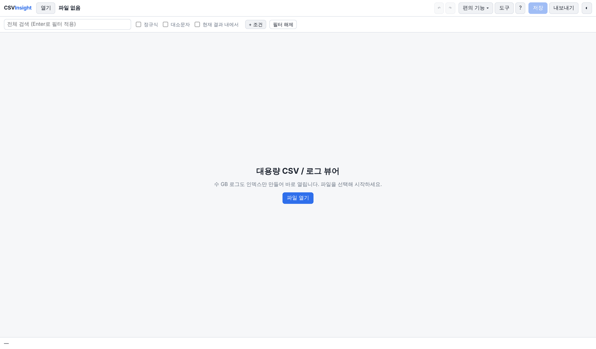

파일을 열기 전 화면입니다. 위에서부터 차례대로,

| 위치 | 이름 | 하는 일 |
|---|---|---|
| 좌측 상단 | **열기** | 파일 선택 창 |
| 가운데 상단 | 파일 이름 / 부제 | 크기 · 행 수 · 인코딩 · 구분자 · 줄바꿈을 한 줄로 요약 |
| 우측 상단 | ↶ ↷ | 실행 취소 · 다시 실행 (100단계) |
| 우측 상단 | **편의 기능 ▾** | 값 분포 · 찾기 · 북마크 · 멀티 서치 · 열 패널을 꺼내는 서랍 |
| 우측 상단 | **도구** | 행 삽입/삭제, 중복 제거, 행 높이, 행으로 이동 |
| 우측 상단 | **?** | 단축키 목록 |
| 우측 상단 | **저장 / 내보내기** | 원본 덮어쓰기 / 다른 이름으로 저장 |
| 우측 끝 | ◐ | 라이트 ↔ 다크 테마 |
| 둘째 줄 | 전체 검색 · + 조건 · 필터 해제 | 6장 |
| 맨 아래 | 상태 표시줄 | 전체 행/열 수, 지금 적용된 필터, 선택 범위, 진행률 |

옆 패널을 늘 띄워두면 표가 좁아지기 때문에 **기본값은 닫힘**입니다.
`Ctrl`(macOS는 `⌘`)+`B` 또는 **편의 기능** 버튼으로 열고, `Esc`로 닫습니다.
마지막에 보던 탭을 기억하므로, 다음에 열면 그 탭이 그대로 나옵니다.

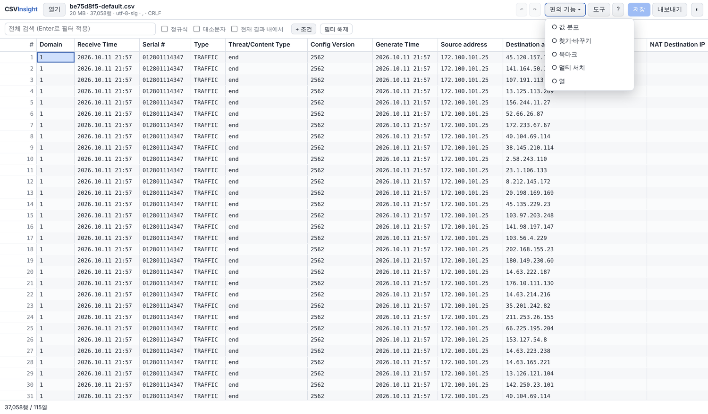

---

## 4. 파일 열기

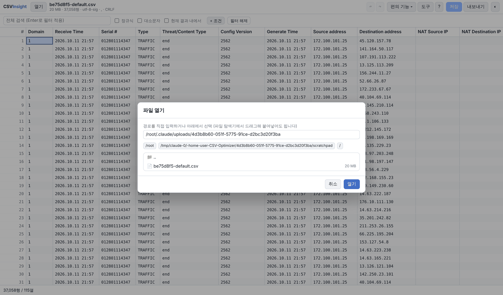

**열기** 버튼을 누르면 서버가 돌고 있는 PC의 폴더를 직접 탐색하는 창이 뜹니다.
Windows라면 `C:\`, `D:\` 같은 드라이브 문자가, macOS라면 홈·데스크톱·다운로드·`/Volumes`가
왼쪽 바로가기로 나옵니다. 경로를 직접 붙여넣어도 됩니다.

파일을 고르면 **인덱싱**이 한 번 돕니다. 진행률이 뜨고, 오래 걸리면 취소할 수 있습니다.

| 파일 크기 | 처음 열기 | 두 번째부터 |
|---|---|---|
| 161 MB / 200만 행 | 0.6초 | 즉시 |
| 1.1 GB / 1,600만 행 | 6.7초 | 즉시 |
| 4.7 GB / 6,000만 행 | 약 20초 | 0.7초 |

두 번째부터 빠른 이유는 원본 옆에 `<파일이름>.csvidx` 라는 인덱스 캐시를 남겨두기 때문입니다.
**행당 8바이트**짜리 파일이라 6천만 행이면 458 MB쯤 됩니다. 원본이 바뀌면 자동으로 무효화되고
다시 만듭니다. 캐시를 남기고 싶지 않다면(읽기 전용 드라이브, 네트워크 드라이브 등)
`--no-cache` 옵션을 주고 실행하세요.

인코딩·구분자·줄바꿈은 자동으로 판별합니다. BOM이 있으면 그대로 따르고, 없으면
UTF-8 → CP949 → CP932 → CP1252 순으로 봅니다. 머리글이 있는지도 값의 생김새를 보고 판단하므로,
머리글 없는 로그도 그냥 열립니다.

> **로그가 계속 쌓이는 파일을 열어둔 경우**
> 열어둔 뒤 원본이 바뀌면(로그가 더 쌓였거나 로테이션됐거나) 화면 위에 경고가 뜨고,
> 저장이 막힙니다. 그 상태로 저장하면 지금 화면에 있는 옛 내용이 새 파일을 덮어버리기 때문입니다.
> 파일을 다시 열어 주세요.

---

## 5. 표 보기

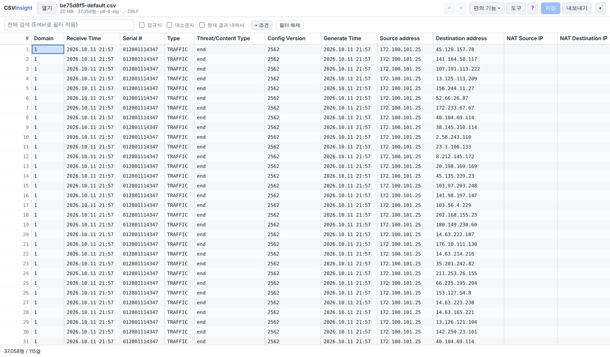

115열짜리 로그도 그대로 뜹니다. 스크롤은 몇 천만 행을 건너뛰어도 1 ms 안쪽입니다.
화면에 보이는 행만 그려서 그렇습니다.

### 열 다루기

머리글을 **우클릭**하면 그 열에 대한 메뉴가 나옵니다.

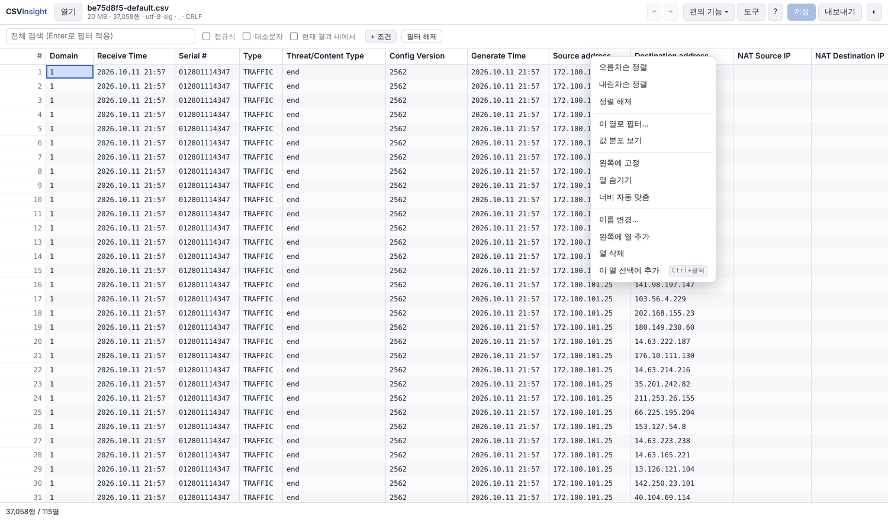

* **너비 자동 맞춤** — 내용에 맞춰 폭을 맞춥니다. 머리글 경계를 끌어서 직접 조절해도 되고,
  경계를 **더블클릭**하면 자동 맞춤입니다.
* **왼쪽 고정** — 스크롤해도 그 열은 화면에 남습니다. `Source address`를 고정해두고
  오른쪽 끝의 `Bytes`를 보는 식으로 씁니다.
* **숨기기 / 이름 변경 / 왼쪽에 열 추가 / 삭제**
* **오름차순·내림차순 정렬** — 숫자처럼 보이는 열은 숫자로 정렬합니다.
* **이 열로 필터…** / **값 분포 보기** — 그 열을 대상으로 6장의 기능을 바로 엽니다.

열이 115개나 되면 메뉴로 하나씩 만지기 번거로우니, 패널의 **열** 탭을 쓰세요.

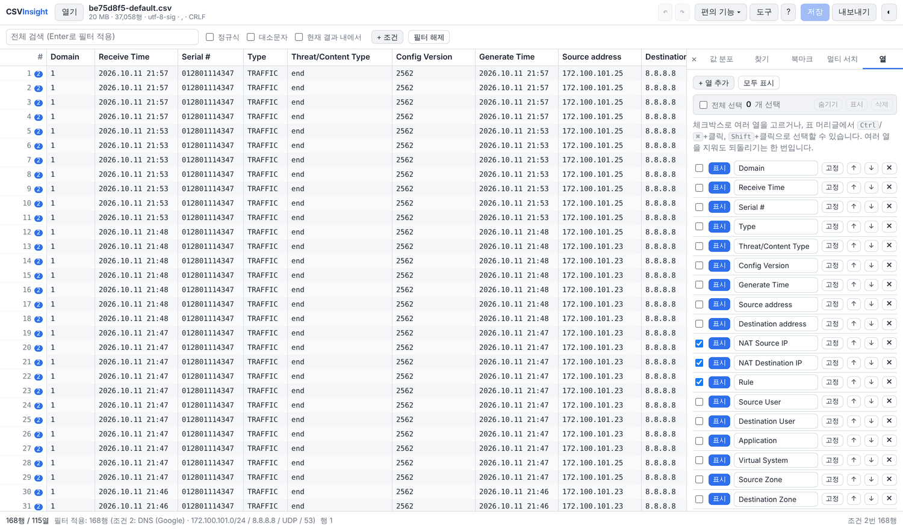

체크박스로 여러 개를 고른 뒤 **숨기기 / 표시 / 삭제**를 한 번에 할 수 있습니다.
머리글에서 `Ctrl`+클릭(범위는 `Shift`+클릭)으로 골라도 같습니다.
**몇 개를 지웠든 되돌리기는 `Ctrl`+`Z` 한 번**입니다.

### 보기 설정

* **도구 → 행 높이**: 좁게 / 보통 / 넓게(줄바꿈 보기). 긴 메시지 열이 있으면 넓게가 편합니다.
* **◐ 버튼**: 다크 테마. 야간 당직에 눈이 덜 아픕니다.

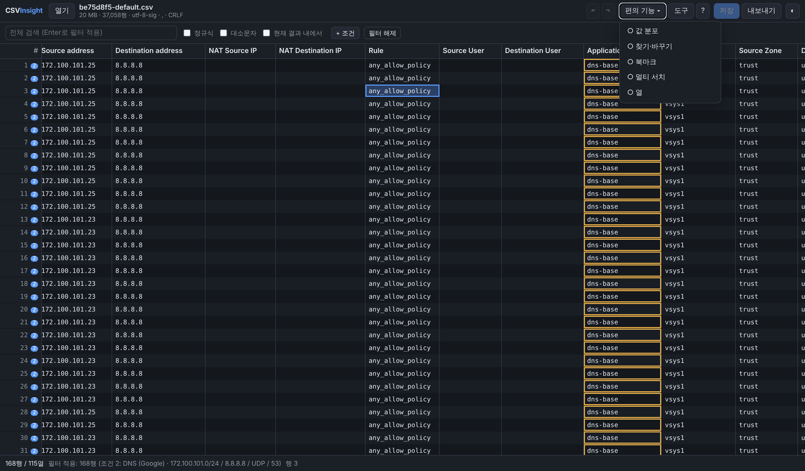

* `level` / `severity` 같은 이름의 열이 있으면 자동으로 찾아서 **ERROR·FATAL은 빨강,
  WARN은 주황**으로 칠합니다.

---

## 6. 찾기와 거르기

### 6-1. 전체 검색 — 제일 많이 쓰는 기능

위쪽 검색창에 아무거나 넣고 **Enter**를 치면 모든 열을 뒤져서 맞는 행만 남깁니다.

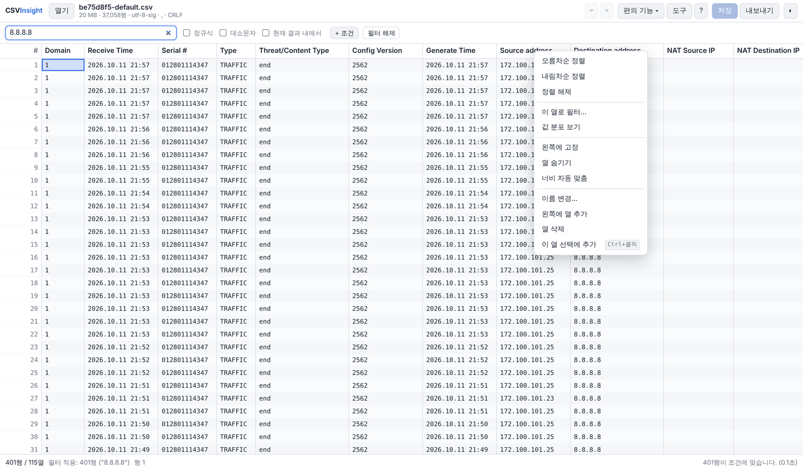

예시 파일에서 `8.8.8.8`을 넣으면 **401행**이 남습니다. 20 MB 파일에서는 눈 깜짝할 사이고,
1.3 GB 파일에서도 보통 1~3초입니다.

* **정규식** 체크 → `user:\d{5}` 같은 패턴 검색
* **대소문자** 체크 → `ERROR`와 `error`를 구분
* **현재 결과 내에서** 체크 → 지금 걸러진 결과 **안에서** 다시 좁힙니다. 단계적으로 파고들 때 씁니다.

필터를 풀려면 **필터 해제**를 누르세요.

### 6-2. 열 단위 조건 (+ 조건)

"이 열이 이 값일 때"처럼 열을 지정하고 싶으면 **+ 조건**입니다.

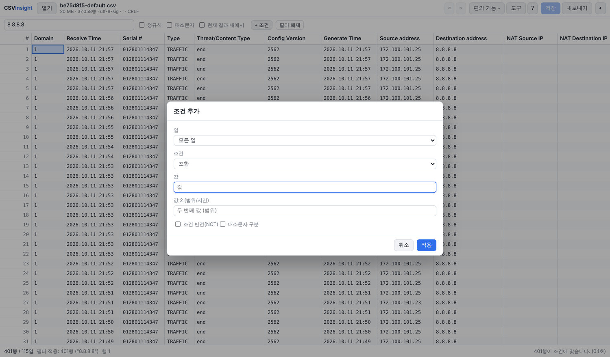

| 종류 | 쓰는 곳 |
|---|---|
| 포함 · 일치 · 시작 · 끝 | 문자열 |
| 정규식 | 패턴 |
| `>` `≥` `<` `≤` · 수치 범위 | `Bytes`, `Elapsed Time` 같은 숫자 열 |
| 시간 범위 | 타임스탬프 열 |
| 목록 | `allow, deny` 처럼 여러 값 중 하나 |
| 빈 값 | 비어 있는 셀만 |
| NOT | 위 모든 조건의 반대 |

조건은 칩(chip) 모양으로 검색창 아래 쌓이고, 여러 개를 걸면 **모두 만족하는 행**만 남습니다.
칩을 클릭하면 고칠 수 있고, × 로 지웁니다.

조건 창을 거치지 않는 지름길도 있습니다. **셀을 우클릭**하면
**이 값으로 필터** / **이 값 제외**가 나옵니다. 눈에 띄는 값을 발견했을 때 제일 빠릅니다.

### 6-3. 값 분포 — 이 열에 뭐가 들어 있나

패널의 **값 분포** 탭에서 열을 고르고 **분석**을 누르면 됩니다.

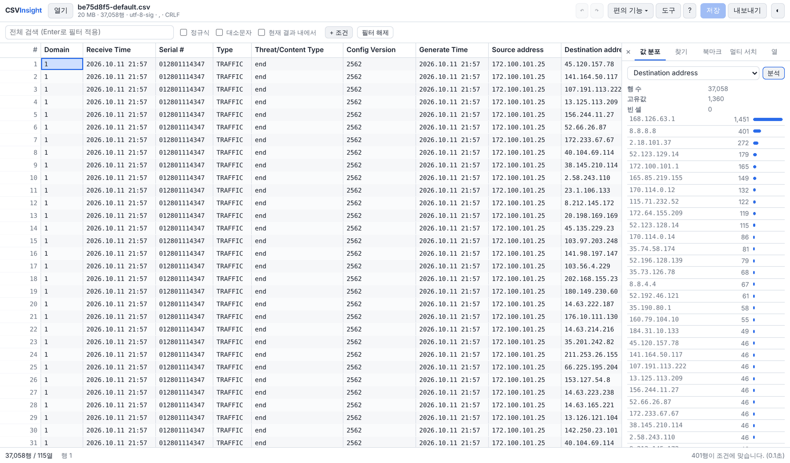

예시 화면은 `Destination address`입니다. 전체 37,058행에 **고유값 1,360개**,
1등이 `168.126.63.1`(KT DNS) **1,451건**, 2등이 `8.8.8.8` 401건이라는 걸 바로 알 수 있습니다.
**값을 클릭하면 그 값으로 바로 필터**가 걸립니다.

숫자 열이면 최소 / 최대 / 평균 / 숫자인 셀 개수까지 같이 계산합니다.
(IP 주소나 `2026.10.11` 같은 날짜는 숫자로 치지 않습니다.)

### 6-4. 찾기 · 바꾸기

패널의 **찾기** 탭은 "몇 번째 일치로 커서를 옮기는" 쪽입니다.

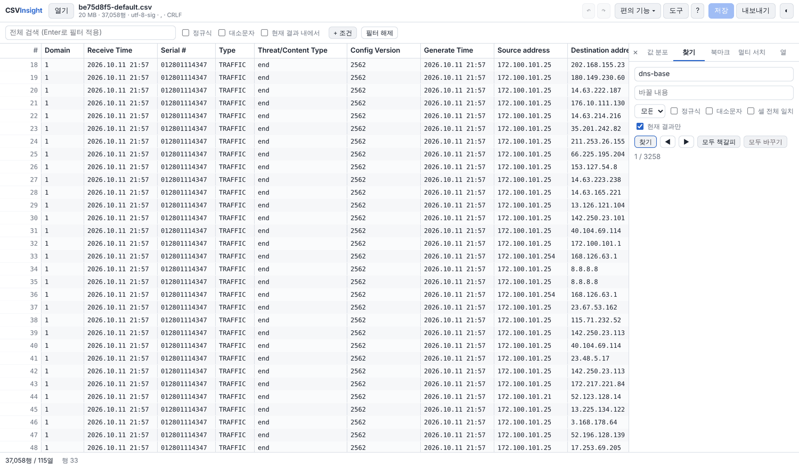

* ◀ ▶ 로 일치 지점을 하나씩 이동 (예시에서는 `dns-base`가 **3,258군데**)
* **모든 열 / 특정 열**, 정규식, 대소문자, **셀 전체 일치** 선택
* **현재 결과만** — 필터로 좁힌 결과 안에서만 찾기
* **모두 바꾸기** — 수만 셀을 바꿔도 되돌리기는 `Ctrl`+`Z` 한 번
* **모두 책갈피** — 일치하는 행 전부를 한 번에 표시 (8장)

---

## 7. 멀티 로그 서처

방화벽 정책표를 들고 "이 정책들이 실제로 쓰이고 있나"를 확인해야 할 때가 있습니다.
조건이 50줄이면 검색을 50번 돌려야 하고, 돌리다 보면 어디까지 했는지도 헷갈립니다.

**멀티 로그 서처는 그 표를 통째로 붙여넣고 한 번에 대조하는 기능입니다.**

### 7-1. 조건표 붙여넣기

패널 → **멀티 서치** 탭. 가운데 칸이 **엑셀처럼 생긴 입력표**입니다.
엑셀에서 정책표 범위를 복사해 커서를 둔 칸에 그대로 `Ctrl`+`V` 하면 됩니다.

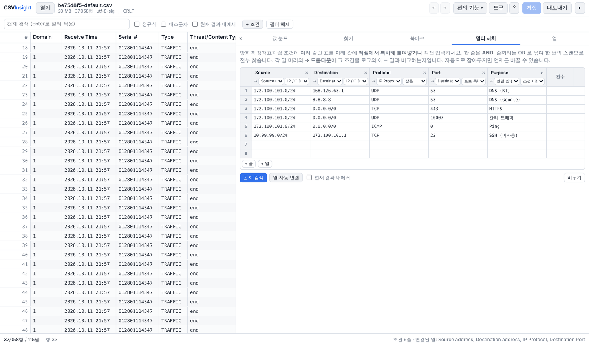

* 셀을 직접 고쳐 쓸 수 있고, **+ 줄** / **+ 열**로 늘립니다
* `Enter`·`↑`·`↓`로 줄 이동, `Tab`으로 칸 이동
* **열 너비는 고정**입니다. 멋대로 바뀌지 않고, 경계를 끌면 조절, **경계를 더블클릭하면
  그 열 내용에 맞게 자동**으로 맞춰집니다
* 설명 열(`Purpose`, `비고`, `용도` 등)은 조건에서 자동으로 빠집니다 — 결과 목록에 이름표로만 붙습니다

**읽는 방식은 정책표 그대로입니다. 한 줄 안의 칸들은 AND, 줄과 줄 사이는 OR.**

지원하는 값 모양:

| 쓸 수 있는 것 | 예 |
|---|---|
| 단일 IP | `8.8.8.8` |
| CIDR | `172.100.101.0/24`, `0.0.0.0/0` |
| 포트 하나 / 목록 | `53`, `22, 23` |
| 프로토콜 | `TCP`, `UDP`, `ICMP` |
| 문자열 포함 · 정규식 · 숫자 비교 | 드롭다운에서 선택 |

### 7-2. 열 연결 — 자동으로 잡되, 어디로 잡혔는지 보여줍니다

붙여넣는 순간 **각 열이 로그의 어느 열과 비교될지**를 추측해서 열 머리 바로 아래
드롭다운에 표시합니다. 위 그림에서 `Source` → `Source address`, `Destination` →
`Destination address`, `Protocol` → `IP Protocol`, `Port` → `Destination Port`로 잡혔고,
`Purpose`는 **연결 안 됨**(조건 아님)입니다.

이 부분을 특히 신경 써서 만들었습니다.

* 장비마다 열 이름이 다릅니다. `src_ip` / `srcip` / `source_address` / `sa` / `출발지IP`가
  전부 `Source`에 붙습니다.
* 이름으로 판단이 안 되면 **실제 값을 표본으로 봅니다.** 그 열에 IP가 들어 있는지,
  `UDP`·`161` 같은 값이 보이는지. 그래서 **머리글이 아예 없는 로그도 연결됩니다.**
* **열 순서를 맞춰 뽑을 필요가 없습니다.** Palo Alto 로그처럼 `Source address` 바로 옆에
  `NAT Source IP`가, `Destination Port` 옆에 `NAT Destination Port`가 있어도
  **변환 전 열**을 고릅니다. 정책표가 말하는 건 NAT 전 주소니까요.
* 그래도 한 건도 안 걸리면, 차선 후보로 바꿔 표본에 다시 대조해 봅니다.
  연결이 틀렸을 때 증상이 "모든 정책 0건"이라서, 그냥 두면 멀쩡한 정책을 '미사용'으로
  오해하게 되기 때문입니다.
* **틀렸으면 드롭다운에서 그 자리에서 바꾸면 됩니다.** 옆의 두 번째 드롭다운은 비교 방식
  (IP/CIDR · 포트 목록 · 같음 · 포함 · 정규식 · 숫자 비교)이고, 이것도 바꿀 수 있습니다.
  연결되지 않은 열은 노란색으로 표시됩니다.

자동 연결을 다시 돌리고 싶으면 **열 자동 연결** 버튼을 누르세요.

### 7-3. 검색하기

**전체 검색**을 누르면 로그를 한 번만 훑으면서 모든 조건을 동시에 대조합니다.

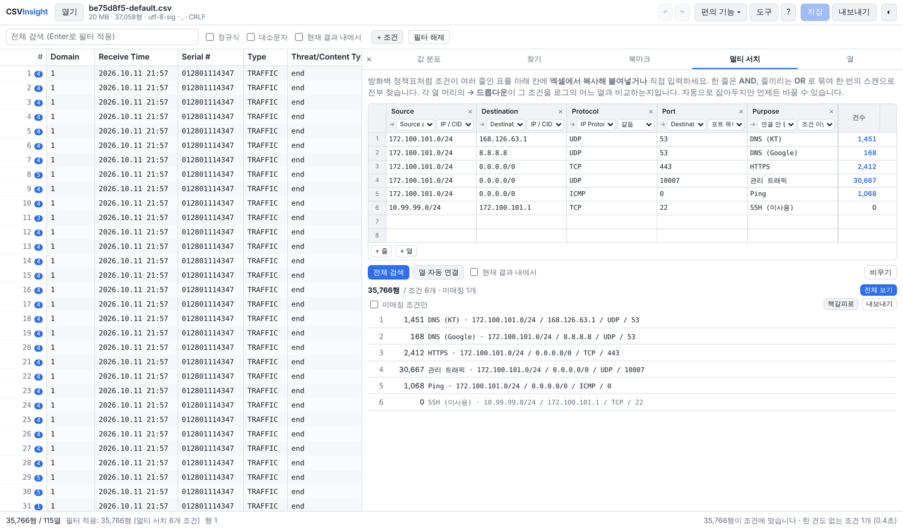

* **조건별 건수가 그 줄 오른쪽 '건수' 칸에 바로 찍힙니다.** `0`은 빨간색입니다.
* 아래쪽에 같은 내용이 목록으로도 나옵니다 (`1,451 DNS (KT) · 172.100.101.0/24 / 168.126.63.1 / UDP / 53`).
* 표 왼쪽 **행 번호 옆의 파란 동그라미 숫자**가 그 행을 잡은 조건 번호입니다.
* 상태 표시줄: `35,766행이 조건에 맞습니다 · 한 건도 없는 조건 1개 (0.4초)`

예시에서는 6줄짜리 정책 중 **6번(SSH, `10.99.99.0/24` → `172.100.101.1` TCP 22)만 0건**입니다.
실제로 이 트래픽이 없었다는 뜻이고, 보통 찾고 싶은 게 바로 이겁니다.
**미매칭 조건만** 체크박스를 켜면 0건인 줄만 남습니다.

> 한 행이 여러 조건에 맞으면 **방화벽과 똑같이 위에서 첫 번째로 맞는 조건**이 그 행을 가져갑니다.
> 그래서 건수를 전부 더하면 전체 적중 행 수가 됩니다.

### 7-4. 조건 하나만 보기

결과 목록에서 줄을 클릭하거나 건수를 클릭하면, 그 조건에 맞는 행만 화면에 남습니다.

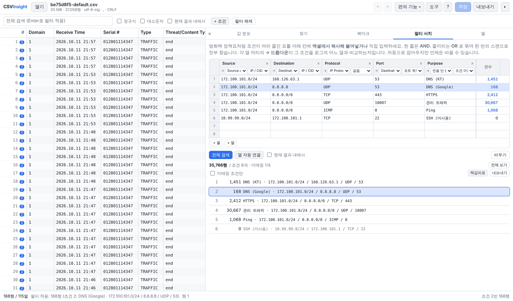

상태 표시줄에 `필터 적용: 168행 (조건 2: DNS (Google) · 172.100.101.0/24 / 8.8.8.8 / UDP / 53)`
처럼 지금 뭘 보고 있는지 그대로 적힙니다. **전체 보기**로 돌아옵니다.

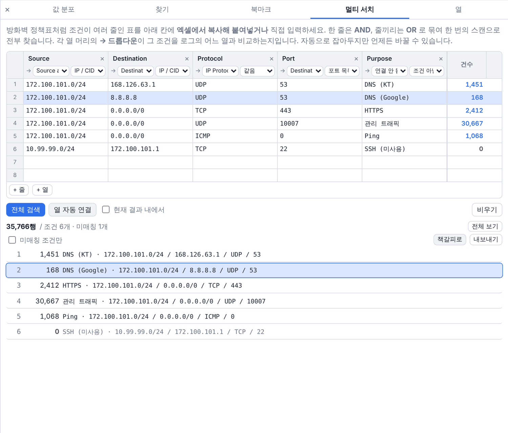

보고 있는 결과는 그대로 **책갈피로** 표시하거나 **내보내기**로 따로 저장할 수 있습니다.
"미사용 정책 목록"이나 "특정 정책에 걸린 트래픽만" 같은 보고서를 만들 때 이 두 버튼이면 끝납니다.

### 7-5. 속도

조건이 몇 개든 스캔은 한 번입니다. 각 조건을 표 전체에서 가장 희귀한 값(대개 포트) 아래에
등록해 두고, 로그 행은 자기가 실제로 가진 값으로 몇 개 조건만 검사합니다.

| | 1코어 | 3코어 |
|---|---|---|
| 1.1 GB / 1,600만 행, 정책 11줄 | 68.6초 | 25.7초 |
| 30만 행, 조건 11개 | 1.6초 | — |
| 30만 행, **조건 500개** | **1.5초** | — |

조건 500개가 11개와 같은 시간이 걸린다는 게 핵심입니다. 붙여넣는 표는 **2,000줄**까지입니다.

---

## 8. 책갈피 (Notepad++ 방식)

"이 행들만 따로 모아두고 싶다"에 쓰는 기능입니다. 저장 전까지 원본은 그대로입니다.

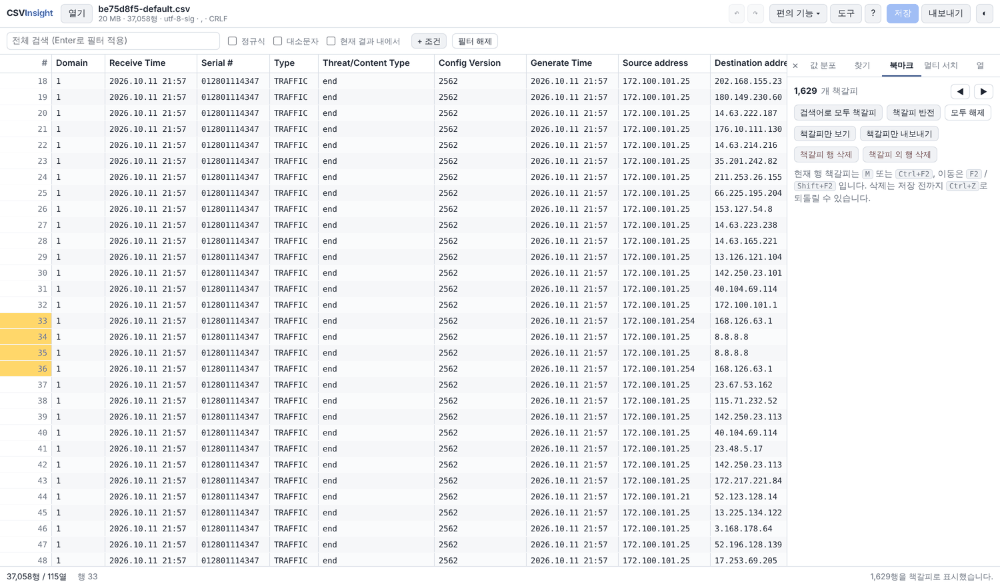

* 행을 고르고 **M** 또는 `Ctrl`+`F2` → 행 번호가 노란색이 됩니다
* **F2** 다음 책갈피, **Shift+F2** 이전
* 찾기 패널의 **모두 책갈피** — 검색어에 맞는 행 전부 (예시에서 `dns-base` → **1,629행**)
* 셀 **우클릭 → 이 값으로 모두 책갈피** — 같은 값을 가진 행 전부
* **책갈피 반전** — 표시된 것과 안 된 것을 뒤집기
* **책갈피만 보기** / **책갈피만 내보내기**
* **책갈피 행 삭제** / **책갈피 외 행 삭제**

"필요한 행만 남기기"는 보통 이 순서입니다:
**필터로 좁힌다 → 모두 책갈피 → 책갈피 외 행 삭제 → 내보내기.**

6천만 행 기준으로 60만 행을 표시하는 데 0.3초, 표시 안 된 5,940만 행을 지우는 데 0.7초,
실행 취소에 0.3초 걸립니다.

---

## 9. 편집

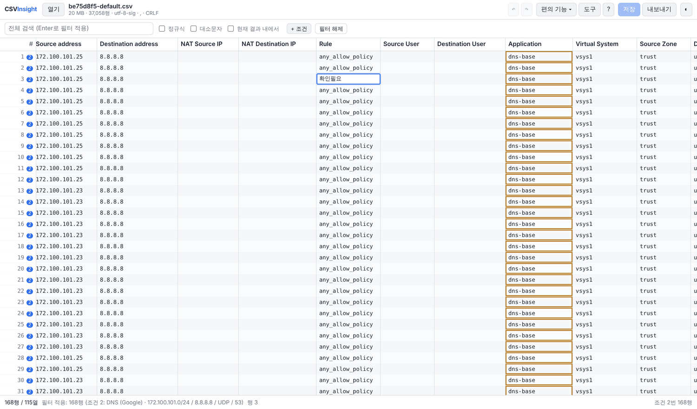

* 셀을 **더블클릭**하거나 그냥 **타이핑**하면 편집이 시작됩니다. `Enter`는 아래 칸,
  `Tab`은 오른쪽 칸으로 넘어갑니다. `Esc`는 취소입니다.
* 범위를 끌어서 선택한 뒤 `Ctrl`+`C` → 엑셀에 그대로 붙여넣을 수 있습니다(TSV).
  반대로 엑셀에서 복사한 블록을 `Ctrl`+`V`로 **여러 셀에 한 번에** 넣을 수도 있습니다.
* `Ctrl`+`D` 아래로 채우기, `Delete` 비우기
* **도구** 메뉴: 행 삽입 / 선택 행 삭제 / 중복 행 제거 / 공백 다듬기 / 행으로 이동

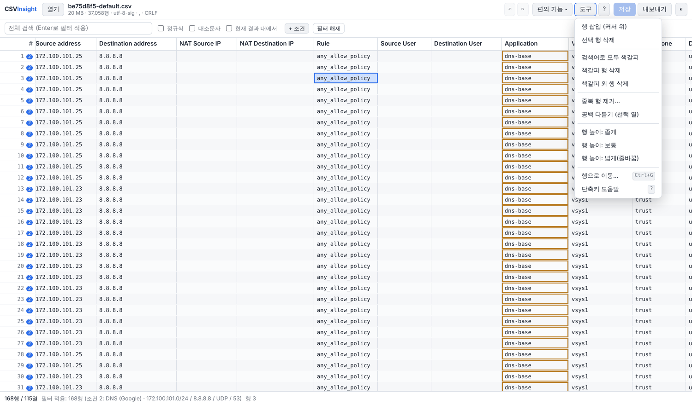

* 실행 취소는 **100단계**입니다. 찾기·바꾸기로 수만 셀을 바꿨든, 열 10개를 한꺼번에
  지웠든, `Ctrl`+`Z` 한 번에 되돌아갑니다.

**다시 말하지만 저장을 누르기 전까지 원본 파일은 바뀌지 않습니다.**
고친 내용은 "바뀐 셀만" 메모리에 들고 있고, 지운 행은 행당 1비트로 표시만 해둡니다.
5,940만 행을 지워도 메모리는 7 MB 남짓입니다.

---

## 10. 저장과 내보내기

### 저장 (원본 덮어쓰기)

`Ctrl`+`S`. 기본으로 `.bak` 백업을 만듭니다.

### 내보내기 (다른 이름으로 저장)

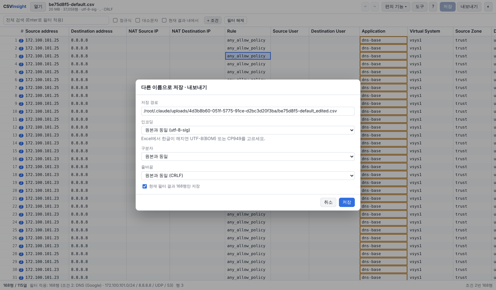

| 선택 | 설명 |
|---|---|
| 저장 경로 | 원본과 다른 이름으로 |
| 인코딩 | 원본과 동일 / UTF-8 / **UTF-8 (BOM 포함 · Excel 권장)** / CP949 / CP932 |
| 구분자 | 원본과 동일 / `,` / `탭` / `;` / `\|` |
| 줄바꿈 | 원본과 동일 / CRLF / LF |
| **현재 필터 결과만 저장** | 지금 화면에 보이는 행만 |

마지막 체크박스가 실무에서 제일 많이 쓰입니다.
5천만 행에서 에러 행만 뽑아 동료에게 보낼 때, 필터를 걸고 이 체크만 켜면 됩니다.

> **엑셀에서 한글이 깨진다면** 인코딩을 `UTF-8 (BOM 포함)` 또는 `CP949`로 고르세요.
> 반대로 BOM이 없던 파일에 CSV Insight가 멋대로 BOM을 붙이는 일은 없습니다 —
> 기본값은 항상 "원본과 동일"입니다.

> **Windows에서 저장이 실패한다면** 그 파일을 엑셀이 열고 있을 가능성이 높습니다.
> "다른 프로그램이 파일을 잡고 있다"는 메시지가 뜨면 엑셀을 닫고 다시 저장해 주세요.

> **디스크 여유**: 저장은 파일 전체를 다시 쓰므로 원본 크기만큼 여유가 필요하고,
> `.bak`까지 켜면 두 배가 필요합니다. 10 GB급 파일이라면 백업 체크를 끄거나
> "다른 이름으로 저장"을 쓰는 편이 안전합니다. 공간이 모자라면 시작하기 전에 알려줍니다.

---

## 11. 명령줄에서 쓰기

화면 없이 배치로 돌려야 할 때가 있습니다. 실행 파일이 CLI도 겸합니다.

```bash
# 파일 정보만 보기 (인코딩·구분자·행 수·열 목록·미리보기)
csvinsight.exe info traffic.csv

# 조건에 맞는 행만 뽑아 새 파일로
csvinsight.exe grep traffic.csv -w "Action=deny" -o deny.csv

# 모든 열에서 문자열 검색
csvinsight.exe grep traffic.csv -c "8.8.8.8" -o dns.csv

# 정규식
csvinsight.exe grep traffic.csv -e "user:\d{5}"

# 인코딩·구분자·줄바꿈 변환 (엑셀용 CSV 만들기)
csvinsight.exe convert traffic.csv -o excel.csv --encoding utf-8-sig --newline crlf
```

`-o`를 생략하면 결과가 화면(표준 출력)으로 나오므로 파이프로 이어 쓸 수 있습니다.
`--workers 1`을 주면 단일 프로세스로 돕니다.

---

## 12. 고객사에 제공할 때의 안전 설정

혼자 쓰는 PC라면 기본값 그대로가 가장 편합니다.
**이 도구를 남의 PC에 설치해 주거나 주소를 다른 사람에게 알려줘야 한다면** 두 가지를 봐 주세요.

### 12-1. 토큰 고정 — 주소를 즐겨찾기에 두려면

기본값은 실행할 때마다 토큰이 달라져 주소를 저장해둘 수 없습니다. 고정하려면:

```bash
:: Windows - 환경변수 쪽을 권합니다
set CSVINSIGHT_TOKEN=정해둔값8자이상
csvinsight.exe D:\logs\traffic.csv

:: 또는 (명령줄에 그대로 노출됩니다)
csvinsight.exe D:\logs\traffic.csv --token 정해둔값8자이상
```

* 최소 **8자**입니다. 그보다 짧으면 거부합니다.
* `--token`으로 준 값은 같은 PC의 다른 사용자에게 보입니다(`ps`, 작업 관리자).
  **환경변수(`CSVINSIGHT_TOKEN`)를 권합니다.**
* 고정 토큰을 쓰면 실행할 때 그 사실을 화면에 알려줍니다. 주소를 아는 사람은
  그 PC에서 열려 있는 파일을 보고 고칠 수 있으니, 아무에게나 줄 주소는 아닙니다.

### 12-2. 열람 범위 묶기 (`--root`) — 이게 더 중요합니다

기본 상태에서는 그 PC의 어떤 폴더든 **열기** 창으로 탐색할 수 있습니다.
혼자 쓸 때는 편하지만, **토큰을 남에게 건네는 순간 그 토큰은 그 PC의 파일 탐색 권한**이 됩니다.

```bash
csvinsight.exe D:\logs\traffic.csv --root D:\logs
:: 또는
set CSVINSIGHT_ROOT=D:\logs
```

묶으면 그 폴더 밖은 **목록에도 나오지 않고, 열 수도 저장할 수도 없습니다.**
상위 폴더로 올라가는 길이 없고, 폴더 안에 바깥을 가리키는 바로가기(심볼릭 링크)가 있어도
따라가지 않습니다. 시작할 때 어느 폴더로 묶였는지 화면에 알려줍니다.

**고객사 제공 시 권장 조합**

```bash
set CSVINSIGHT_TOKEN=고객사가정한값
set CSVINSIGHT_ROOT=D:\logs
csvinsight.exe
```

### 12-3. 다른 PC에서는 접속되지 않습니다

`--host`로 다른 주소에 바인드해도 **접속은 `127.0.0.1` / `localhost`로만 받습니다.**
LAN IP나 도메인으로 들어오면 토큰이 맞아도 거부되고, 거부 사유도 토큰 문제와 구분해서 알려줍니다.
다른 PC에서 쓰게 하려는 의도가 아니라, 브라우저 다른 탭의 웹페이지가 이 서버를 두드리는 것
(DNS rebinding)을 막기 위한 장치입니다.

여러 사람이 써야 한다면 **각자 자기 PC에서 실행**하는 것이 맞는 사용법입니다.

---

## 13. 성능과 한계

### 측정값 (4코어 리눅스 컨테이너, 8열 로그)

| 작업 | 161 MB / 200만 행 | 4.7 GB / 6,000만 행 |
|---|---|---|
| 처음 열기(인덱싱) | 0.6초 | 약 20초 |
| 다시 열기 | 즉시 | 0.7초 |
| 임의 위치 200행 읽기 | 1.2 ms | 1.0 ms |
| `level = FATAL` 필터 | 0.4초 | 13초 |
| 검색 결과 모두 책갈피 | 0.01초 | 0.3초 |
| 책갈피 외 행 전부 삭제 | 0.03초 | 0.7초 |
| 인덱스 캐시 크기 | 15 MB | 458 MB |

메모리는 파일 크기와 **무관하게 50 MB 내외**입니다.
10 GB 파일이면 처음 열 때 40~50초 인덱싱, 그 뒤로는 즉시 열립니다.

### 알아두실 한계

* 전체 정렬은 **500만 행**까지입니다. 그보다 크면 먼저 필터로 줄이고 정렬하세요.
* 중복 행 제거는 서로 다른 값 **500만 개**까지 추적합니다.
* 정규식에서 고정 문자열을 뽑을 수 없는 형태(`reset|expired`, `[a-z]+`)는 전체 파싱이 필요해
  느립니다. 공통 문자열이 있는 형태로 쓰거나 열 조건을 먼저 걸어 좁혀 주세요.
* 찾기·바꾸기와 값 분포는 아직 단일 프로세스입니다(필터·책갈피·멀티 서치는 여러 코어 사용).
* 멀티 서치는 **IPv4만** 압니다. IPv6 CIDR은 조건에서 빠집니다.
* 붙여넣는 조건표는 **2,000줄**까지입니다.
* 한 번에 **한 파일**만 엽니다(탭/분할 보기 없음).

---

## 14. 자주 묻는 질문

**Q. 인터넷에 데이터가 올라가지는 않나요?**
A. 올라가지 않습니다. 외부로 나가는 통신 자체가 없고, 접속도 내 PC(`127.0.0.1`)로만 받습니다.
화면이 브라우저일 뿐, 클라우드 서비스가 아닙니다.

**Q. 실수로 저장했는데 되돌릴 수 있나요?**
A. 저장할 때 기본으로 `원본이름.bak` 백업을 만듭니다. 그 파일의 확장자를 되돌리시면 됩니다.

**Q. `.csvidx` 파일은 지워도 되나요?**
A. 네. 인덱스 캐시일 뿐이라 지워도 데이터는 멀쩡하고, 다음에 열 때 다시 만들어집니다(그만큼 느려질 뿐).
애초에 만들지 않게 하려면 `--no-cache`를 주세요.

**Q. 멀티 서치에서 모든 정책이 0건으로 나옵니다.**
A. 열 연결이 틀렸을 가능성이 가장 큽니다. 조건표 열 머리 아래 드롭다운이 로그의 어느 열을
가리키는지 확인하고, 아니라면 직접 고르세요. 자동 연결은 이 증상을 막으려고 차선 후보까지
대조해 보지만, 로그 형식이 특이하면 놓칠 수 있습니다.

**Q. 건수를 다 더해도 전체 적중 행 수와 다른데요?**
A. 같아야 정상입니다. 한 행은 **맨 위에서 처음 맞는 조건 하나**에만 들어갑니다(방화벽과 동일).

**Q. 열 수가 115개라 보기 힘듭니다.**
A. 패널 → **열** 탭에서 안 보는 열을 체크해 숨기세요. 자주 보는 열은 머리글 우클릭 →
**왼쪽 고정**을 걸어두면 편합니다.

**Q. 엑셀에서 열면 한글이 깨집니다.**
A. 내보내기에서 인코딩을 `UTF-8 (BOM 포함)` 또는 `CP949`로 고르세요.

**Q. 파일이 계속 커지는 중인데 열어둬도 되나요?**
A. 보는 건 괜찮습니다. 다만 원본이 바뀌면 경고가 뜨고 저장이 막힙니다. 저장이 필요하면
파일을 다시 열어 주세요.

**Q. 백신이 실행 파일을 막습니다.**
A. 코드 서명 인증서가 아직 붙어 있지 않아 생기는 일입니다. 사내 정책상 서명이 필요하면
알려 주세요.

---

## 15. 단축키

Windows/Linux는 `Ctrl`, macOS는 `⌘`입니다. 화면의 **?** 버튼에서도 볼 수 있습니다.

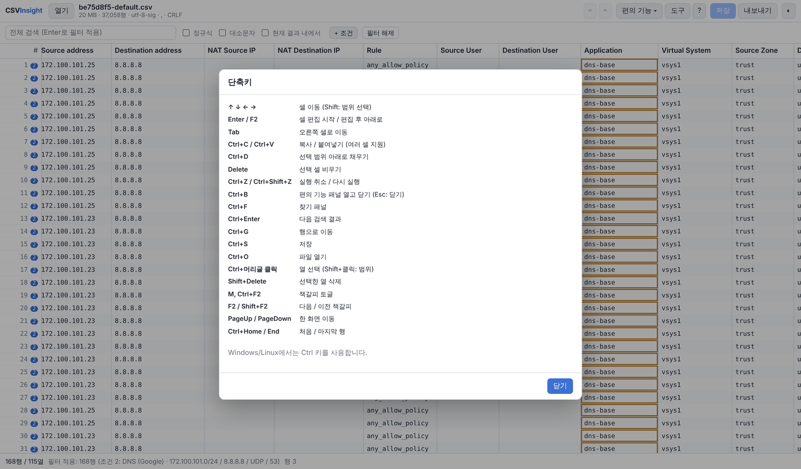

| 키 | 동작 |
|---|---|
| `↑ ↓ ← →` (+`Shift`) | 셀 이동 / 범위 선택 |
| `Enter`, `F2` | 편집 시작 · 편집 후 아래 칸으로 |
| `Ctrl/⌘ + C`, `V` | 복사 / 붙여넣기 (여러 셀) |
| `Ctrl/⌘ + D` | 선택 범위 아래로 채우기 |
| `Delete` | 선택 셀 비우기 |
| `Ctrl/⌘ + Z`, `Shift + Z` | 실행 취소 / 다시 실행 |
| `Ctrl/⌘ + B`, `Esc` | 편의 기능 패널 열기·닫기 / 닫기 |
| `Ctrl/⌘ + F`, `Enter` | 찾기 패널 / 다음 결과 |
| `Ctrl/⌘ + G` | 행 번호로 이동 |
| `Ctrl/⌘ + S`, `O` | 저장 / 파일 열기 |
| `Ctrl/⌘ + +`, `-` | 행 삽입 / 선택 행 삭제 |
| `Ctrl/⌘ + 머리글 클릭` | 열 선택 (`Shift`+클릭: 범위) |
| `Shift + Delete` | 선택한 열 삭제 |
| `M`, `Ctrl/⌘ + F2` | 책갈피 토글 |
| `F2` / `Shift + F2` | 다음 / 이전 책갈피 |

---

*문의나 수정 요청은 이 문서를 고쳐서 돌려주셔도 됩니다.*
